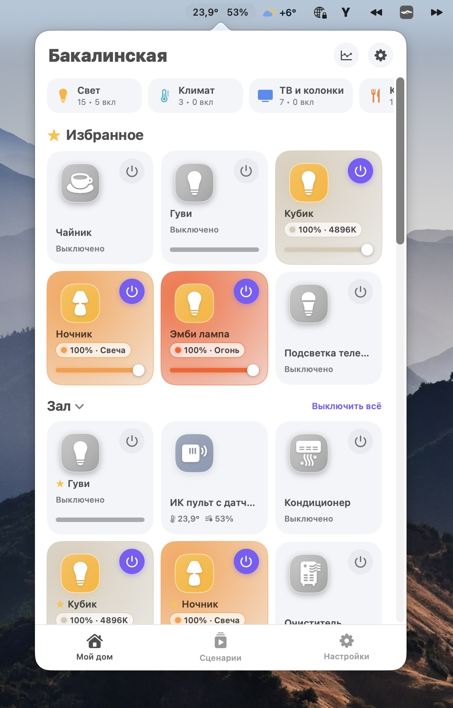
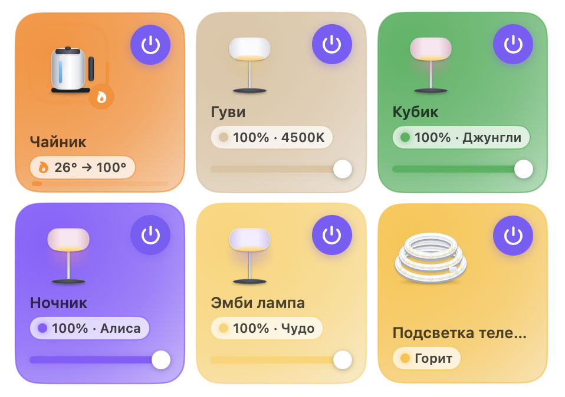
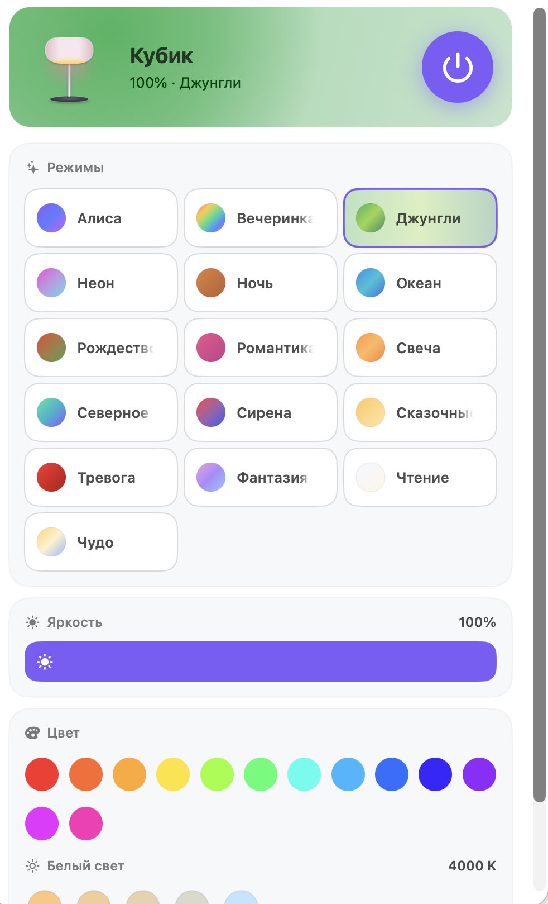
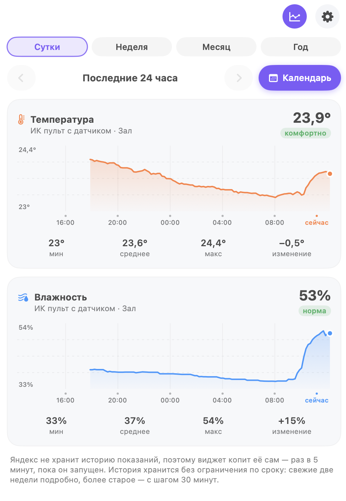
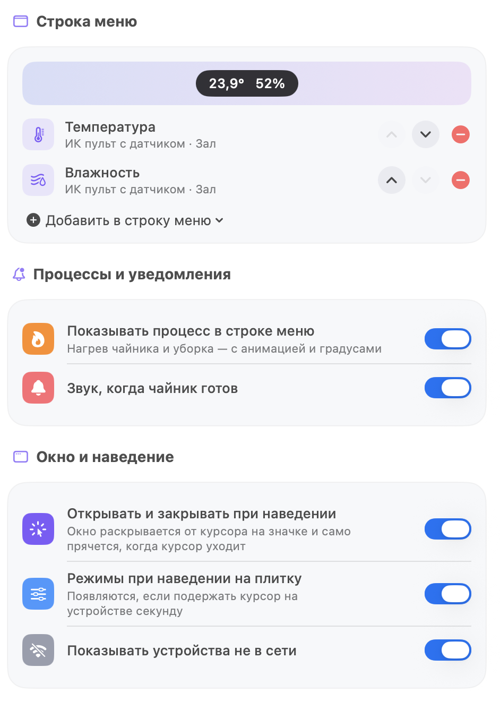

# Мой дом — умный дом Яндекса в строке меню macOS

Лёгкий нативный виджет для Mac: все устройства «Умного дома с Алисой» по комнатам, управление в один клик,
сценарии, показания датчиков и **полная история температуры, влажности, CO₂ и давления** с навигацией по любому дню.
Без Electron, без зависимостей, одним файлом Swift.

> **Неофициальный проект.** Не связан с компанией Яндекс и не одобрен ею. «Яндекс», «Алиса», «Станция» — товарные знаки их владельцев, упоминаются только для описания совместимости. Приложение использует открытый API умного дома Яндекса; логотипов и графики Яндекса в репозитории нет. См. [NOTICE.md](NOTICE.md).
> English summary — [README.en.md](README.en.md).

<p align="center"></p>

## Скриншоты

| Плитки устройств | Карточка устройства |
|---|---|
|  |  |

| Статистика | Настройки и строка меню |
|---|---|
|  |  |

## Возможности

**Управление**
- Устройства по комнатам и домам, избранное (порядок меняется), фильтры по категориям.
- Комнаты переставляются перетаскиванием за ручку (появляется при наведении) или командами «В самый верх» / «В самый низ» в меню комнаты; в настройках — стрелки.
- Включение/выключение, яркость прямо на плитке, цвет, цветовая температура, световые сцены, режимы климата, целевая температура.
- Быстрая панель при наведении на плитку, прокрутка колесом на плитке меняет яркость.
- Сценарии Алисы одним нажатием: минималистичные плитки одним шрифтом, название плавно уходит в белый, цвет сцены — в заливке и рамке.
- Кнопка питания на плитке видна всегда, в том числе у выключенного устройства; лишних кнопок у колонок нет (только режимы).
- Состояние обновляется быстро: каждые 6 секунд, пока окно открыто, поэтому физическое нажатие на лампе или розетке появляется в виджете почти сразу.
- Чайник и другие «процессы» (нагрев, стирка, уборка): кольцо прогресса на плитке, плашка вверху, значок в строке меню.
- Подсветка плитки цветом, которым сейчас светит устройство.

**Строка меню**
- Настраиваемый набор: число включённых устройств, свет, температура, влажность, CO₂, любое устройство.
- Температура и влажность — только числа; обычные значения — как у системы, при отклонении от нормы
  (холодно, жарко, сухо, сыро) число меняет цвет на предупреждающий.
- Окно открывается по клику или при наведении курсора на значок.
- Красная точка на значке, когда вышла новая версия; в окне — плашка «Что нового» из описания релиза, её можно закрыть.

**Статистика**
- Графики температуры, влажности, CO₂, давления и мощности. Порядок: комната → датчик → графики за сутки, неделю, месяц, год.
- Периоды: сутки, неделя, месяц, год, свой диапазон; стрелки ‹ › по дням/неделям/месяцам/годам; календарь с отметками дней, за которые есть данные.
- Ползунок при наведении мыши: точное время и значение.
- История **хранится без ограничения по сроку** и остаётся только на вашем Mac. Подробности — [docs/STATISTICS.md](docs/STATISTICS.md).

**Обновления**
- В настройках, в самом верху, видны версия приложения и разработчик, кнопка «Проверить обновление» и ссылка на последний релиз.
- Раз в сутки проверка идёт сама (можно выключить). Приложение **ничего не устанавливает само**: оно только показывает, что нового, и даёт ссылку.

**Устройства**
- Реалистичные векторные иконки для всей линейки устройств Яндекса и устройств других производителей, подключённых через Яндекс.
  Размеры соответствуют настоящим: Лайт меньше Мини, Мини меньше Миди, Станция больше, Макс — самая крупная.
  Для типов без рисунка показывается значок. Таблица — [docs/DEVICES.md](docs/DEVICES.md).

## Установка

Требуется **macOS 13 или новее** и Command Line Tools (установщик предложит их поставить сам; Xcode не нужен).

### Вариант 1. Готовый установщик
1. Скачайте `YaHome-<версия>.zip` из раздела **Releases**, распакуйте.
2. Правый клик по «Установить Мой дом.command» → **Открыть** → подтвердите.
3. Подождите 1–2 минуты: приложение собирается на вашем Mac из исходников и ставится в `~/Applications/YaHome.app`.
4. В строке меню появится домик. Нажмите «Войти через Яндекс» и подтвердите доступ в браузере.

Обновление — скачать новый релиз и запустить новый установщик (настройки и история сохраняются). Приложение само подскажет, когда он вышел. Удаление — «Удалить Мой дом.command».

### Вариант 2. Из исходников
```bash
git clone https://github.com/<ваш-аккаунт>/YaHome.git
cd YaHome
python3 tools/make_installer.py     # соберёт dist/ с установщиком
# или только сборка бинарника:
tools/build.sh build/YaHome && build/YaHome
```

## Вход и безопасность
- Вход через `oauth.yandex.ru` или вставкой собственного OAuth-токена.
- Токен хранится в **связке ключей macOS**. В установщике и репозитории нет ничьих личных данных.
- Обращения только к `api.iot.yandex.net` и `oauth.yandex.ru`, а также к `api.github.com` для проверки новой версии (читается только номер и описание релиза; проверку можно выключить в настройках). Подробности — [SECURITY.md](SECURITY.md), [docs/AUTH.md](docs/AUTH.md).

## Как это устроено
Краткая схема (полностью — [docs/ARCHITECTURE.md](docs/ARCHITECTURE.md)):

```
 Яндекс IoT API ──► HomeModel (ObservableObject) ──► SwiftUI: плитки / детали / сценарии / статистика
        ▲                  │  └─► history.json (многоуровневое сжатие)
   Keychain (токен)        └────► AppDelegate: NSStatusItem + NSPopover (строка меню)
```

- **Один файл, один `swiftc`.** Приложение собирается обычным компилятором из Command Line Tools — поэтому установщик
  может собирать его у пользователя, без подписи разработчика и без готовых бинарников.
- **Состояние** — `ObservableObject` с `@Published`; без `@State`, макросов и сторонних библиотек.
- **Опрос API** адаптивный: каждые 6 секунд, пока окно открыто, раз в минуту в фоне; устройство «занято» (нагрев, процесс) опрашивается чаще. Состояния обновляются по данным устройств, чтобы не показывать устаревшее «включено».
- **История** пишется раз в 5 минут и сжимается многоуровнево, поэтому файл остаётся небольшим на годы вперёд.

## Ограничения
- Это клиент к публичному API Яндекса: набор доступных свойств и возможностей определяет сам API и навык производителя.
- Автоматических тестов нет; проверка — типизация в CI и ручная проверка на реальном доме.
- Интерфейс только на русском.
- Показываются только устройства, подключённые к Умному дому Яндекса. Камеры и устройства, которых нет в Яндексе (например, напрямую в Mi Home), недоступны.

## Участие
Смотрите [CONTRIBUTING.md](CONTRIBUTING.md). Больше всего помогут сообщения о ваших устройствах, которые показываются неверно.

## Лицензия
[MIT](LICENSE) © Lenar Abdrakhmanov
